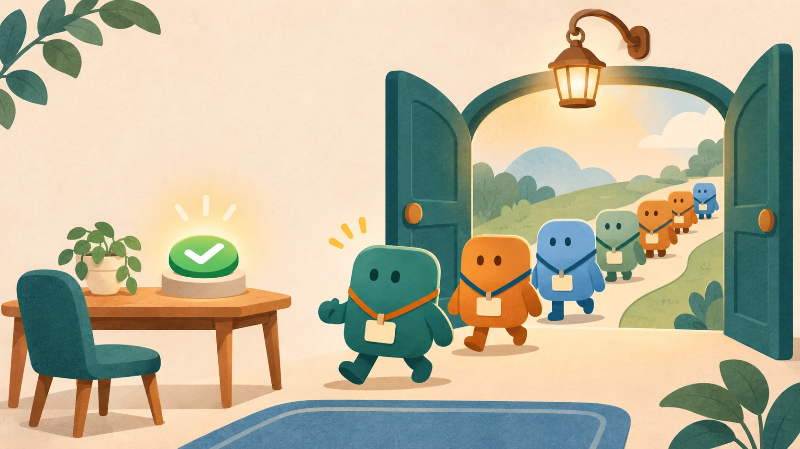
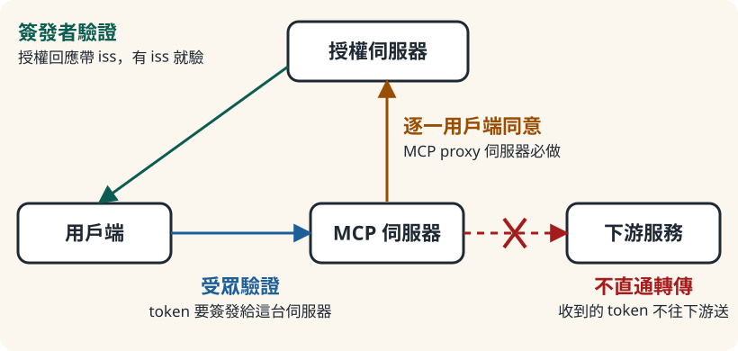
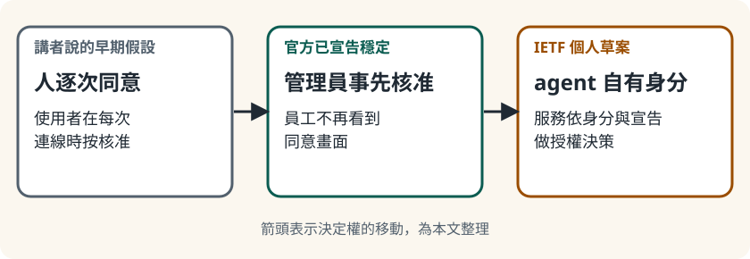
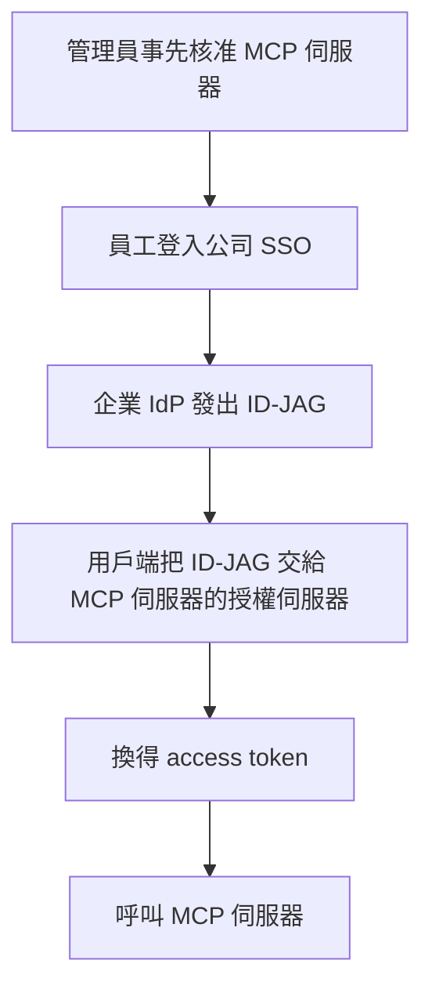
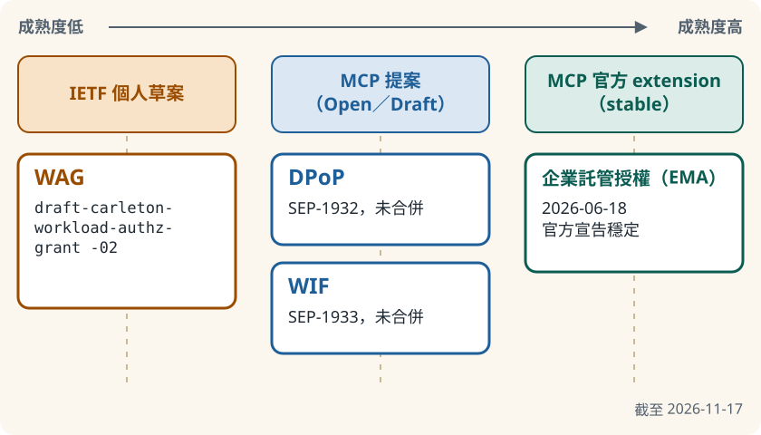

# 同意鈕沒人按之後：MCP 安全兩年，從各自發揮走到給 agent 身分

> 本導讀的分析與撰稿由 AI 模型完成，不是人類分析，也沒有經過人工逐句校稿；內容依 YouTube 機器字幕整理，可能有誤聽。

*圖：原創 AI 插畫，以沒人按的同意鈕和各自帶著識別證的小角色比喻 agent 時代的授權。*

MCP 設計授權流程時，心裡的畫面很具體：電腦前坐著一個人，跳出登入提示，他按下「核准」。Den Delimarsky 在演講後段承認，**這個畫面撐不住了**。模型能獨立運作的範圍愈拉愈大，「不會再有一個人去點擊那個按鈕」（[16:35](https://www.youtube.com/watch?v=b0v2zCLOdcM&t=995s)）〔講者〕。

Delimarsky 自稱是 MCP 的主要維護者之一（[0:04](https://www.youtube.com/watch?v=b0v2zCLOdcM&t=4s)），他的個人網站也寫著 Lead Maintainer，2026 年 1 月起任職 Anthropic〔講者〕。這支影片由 Agentic AI Foundation 頻道於 2026-11-16 上傳，長度約 23 分鐘，單人演講。他談的是 MCP 兩年來的安全工作，主線有三條：規格怎麼收斂、SDK 與最佳實務怎麼跟上、下一步要補什麼。導讀依序走過這三條。

標籤說明：〔講者〕為演講口述或講者本人網站的自述；〔官方〕為 MCP 規格、官方部落格、IETF 或廠商官方頁；〔本文類推〕為本文從講者內容延伸的分析，不是講者說法，也不是官方結論。

## 三十秒版

- 授權從各自發揮收斂到 OAuth：官方規格 2025-03-26 加入以 OAuth 2.1 為基礎的授權框架，2025-06-18 起把 MCP 伺服器歸類為 OAuth 的 resource server〔官方〕。
- 講者把安全分成規格、SDK、最佳實務三根支柱；SDK 這一根靠一致性測試（conformance）與等級制度當契約。
- 部署中補上的幾道防線：逐一用戶端同意、token 不直通轉傳、受眾驗證。簽發者驗證（防 mix-up 混淆攻擊）要到 2026-07-28 版才進規格〔官方〕。
- 下一步有四塊：企業託管授權已由官方宣告穩定；DPoP（持有證明）與工作負載身分聯邦仍是提案；WAG（工作負載授權授予）講者說將會成為 OAuth 標準，目前只是 IETF 的個人草案。

## 各自發揮的代價：為什麼 MCP 要有主見

演講第一個論點是一致性。MCP 剛推出時，授權有許多部分交給個別開發者決定：想用 API 金鑰就用，想用憑證就自己建（[1:30](https://www.youtube.com/watch?v=b0v2zCLOdcM&t=90s)）〔講者〕。Delimarsky 指出這樣做的後果：跑在手機上的 LLM 用戶端與跑在企業內的用戶端行為不同，得加一堆自訂處理，「這就很不 MCP」（[2:15](https://www.youtube.com/watch?v=b0v2zCLOdcM&t=135s)）。他的結論是，**MCP 是一個有主見的協定，包括授權**（[7:33](https://www.youtube.com/watch?v=b0v2zCLOdcM&t=453s)）〔講者〕。

另一層理由是人。他認為**不是每個人都是資安專家**，也不是每個人想成為專家。把 token 怎麼存、怎麼更新、不該傳給誰這些事留給不懂的人，只會走上糟糕的路。他的設計原則是「讓做正確的事變得容易，而讓做錯誤的事變得極度、極度困難」（[5:45](https://www.youtube.com/watch?v=b0v2zCLOdcM&t=345s)）〔講者〕。

演進的幾個節點，官方文件可以逐一對上（版本號代表最後一次不相容變更的日期，不等於發布日）：

| 規格版本 | 與授權有關的變動 | 來源等級 |
|---|---|---|
| 2025-03-26 | 加入以 OAuth 2.1 為基礎的授權框架（引用的是 IETF 草案 draft-ietf-oauth-v2-1-13） | 〔官方〕 |
| 2025-06-18 | MCP 伺服器歸類為 OAuth resource server；要求用戶端實作 RFC 8707 Resource Indicators；新增獨立的 security best practices 頁 | 〔官方〕 |
| 2025-11-25 | 新增 OpenID Connect Discovery 支援，以及 Client ID Metadata Documents（CIMD） | 〔官方〕 |
| 2026-07-28 | 簽發者參數 `iss`（RFC 9207）；動態用戶端註冊（RFC 7591）降為 Deprecated | 〔官方〕 |

講者說 2025 年 6 月版把授權伺服器交給專業人士，用 Okta 的公司就用 Okta，用 Microsoft 的就用 Entra ID（[6:09](https://www.youtube.com/watch?v=b0v2zCLOdcM&t=369s)）。規格的實際寫法是授權伺服器可以與資源伺服器同機，也可以是獨立實體〔官方〕。方向上確實鼓勵分離，但**規格沒有強制**。他還強調，MCP 的授權規格建立在 OAuth 社群既有的 RFC 之上，「它們不是 MCP 的東西」（[7:10](https://www.youtube.com/watch?v=b0v2zCLOdcM&t=430s)）〔講者〕；官方文件引用的 RFC 包括 9728、8414、7591、8707〔官方〕。

## 規模變成責任：SDK、揭露與一致性測試

講者用一個數字開場：SDK 與參考伺服器自推出以來累計下載 41.7 億次；他說一個多月前還是 30 億（[8:04](https://www.youtube.com/watch?v=b0v2zCLOdcM&t=484s)）〔講者〕。他要講的是規模帶來的責任：到了這個量級，任何一個缺口或設定錯誤都代價很大。**開發者不讀規格，他們下載套件**，所以 SDK 本身也得有走向安全的路徑（[9:12](https://www.youtube.com/watch?v=b0v2zCLOdcM&t=552s)）。他還說 TypeScript SDK 在他上次查的時候有將近 30 萬個公開儲存庫依賴（[9:43](https://www.youtube.com/watch?v=b0v2zCLOdcM&t=583s)），Python 約 2.5 萬個（[10:12](https://www.youtube.com/watch?v=b0v2zCLOdcM&t=612s)）〔講者〕。

SDK 這一根支柱，他列了三件事：標準的漏洞揭露流程、跨 SDK 協調修補、一致性測試。官方 SECURITY.md 載明漏洞走 GitHub Security Advisory 通報，不可走公開 issue，且由 SDK 維護者協調讓修補與公告同步發布〔官方〕，與他描述的協調式揭露方向一致。

談到一致性測試，他說了全場最值得記的一句：沒有這種契約，規範「基本上就只是一項建議」，而建議通常會被忽略（[15:00](https://www.youtube.com/watch?v=b0v2zCLOdcM&t=900s)）〔講者〕。官方的 SDK 等級頁寫得更具體：**Tier 1 的一致性測試通過率要求 100%**，Tier 2 為 80%，連續四週失敗會降級〔官方〕。至於約 116 個情境、接近三分之一以資安為導向（[14:30](https://www.youtube.com/watch?v=b0v2zCLOdcM&t=870s)），這兩個數字只有講者這麼說。

> 重點：一致性測試約束的是 SDK 對規格的符合度。用某個通過測試的 SDK 寫出來的伺服器是否安全，還取決於部署設定與業務邏輯，這一層測試管不到〔本文類推〕。

## 部署學到的四條教訓

講者說，這些最佳實務大多源自觀察大家怎麼把 MCP 部署到正式環境（[11:58](https://www.youtube.com/watch?v=b0v2zCLOdcM&t=718s)）。他點名了四件事，下面逐項對照官方文件，再補上防禦以外的視角。

**逐一用戶端同意。** 部署者遇到混淆代理人（confused deputy）情境，使用者同意了不該同意的東西（[11:19](https://www.youtube.com/watch?v=b0v2zCLOdcM&t=679s)）〔講者〕。官方 security best practices 寫明 MCP proxy 伺服器 MUST 實作逐一用戶端同意〔官方〕。

**token 不直通轉傳。** 伺服器拿到的 token 不該再轉傳給別人（[11:37](https://www.youtube.com/watch?v=b0v2zCLOdcM&t=697s)）〔講者〕。官方的寫法是 MCP 伺服器 MUST NOT 接受不是明確簽發給自己的 token，這個要求在 2025-06-18 版就有〔官方〕。受眾驗證同樣自 2025-06-18 起，依 RFC 8707 要求 MCP 伺服器驗證 token 的受眾〔官方〕。

**簽發者驗證。** 講者說這是「在最近一版規格中推出」（[11:51](https://www.youtube.com/watch?v=b0v2zCLOdcM&t=711s)）〔講者〕。對照官方 2026-07-28 版 changelog，授權伺服器 SHOULD 在授權回應帶 `iss`，用戶端在 `iss` 存在時 MUST 驗證〔官方〕。講者的語氣像是已經全面擋下混淆攻擊，實際條件是**授權伺服器有回傳 `iss`，用戶端才必須驗**。

**檔案上傳。** 他正在與社群討論，並說「可能是很有風險的操作」，因為多了一條內容外洩的管道（[12:43](https://www.youtube.com/watch?v=b0v2zCLOdcM&t=763s)）〔講者〕。官方資料顯示，File Uploads 工作群組與提案 SEP-2356 仍在進行；2026-11-10 的官方部落格預告這個 extension 草案年底前定案，目前仍屬實驗階段〔官方〕。講者沒有給具體的防護設計。

*圖：四道防線各落在哪個位置，本文依官方規格條文整理，非講者投影片。*

講者談的幾乎都是防禦設計。下表把偵測與治理補上，這兩欄是本文的延伸，不是講者說法：

| 風險 | 講者談到的防禦 | 偵測訊號（本文類推） | 治理問題（本文類推） |
|---|---|---|---|
| 混淆代理人 | 逐一用戶端同意 | 授權伺服器日誌中，同一使用者對陌生 client_id 或 redirect_uri 的同意事件 | 同意紀錄是授權的稽核證據；agent 代為按同意時，同意的意義還成立嗎 |
| token 直通 | 受眾驗證 | gateway 日誌中受眾（`aud`）不符而被拒絕的次數 | 轉傳方與接收方都有規格義務，責任歸屬要分開寫 |
| 混淆攻擊 | 簽發者驗證 | 授權回應缺少 `iss` 的比例；`iss` 與預期伺服器不符的事件 | 採購 IdP 時可把是否回傳 `iss` 列入檢查項 |
| 檔案上傳 | 設計階段納入安全考量 | 用戶端上傳事件日誌、企業出口端的大量上傳流量 | 上傳到第三方 MCP 伺服器等同把資料提供給第三方 |

## 同意鈕之後：四塊還在補的拼圖

演講後半，講者說世界變了：早期假設有人點按鈕，現在不會有人在旁邊（[15:59](https://www.youtube.com/watch?v=b0v2zCLOdcM&t=959s)）〔講者〕。他列出四個元件。

*圖：決定權的移動（本文整理，非講者投影片）。*

**企業託管授權（EMA）。** 他的說法是管理員連線一次，組織內的人從此看不到同意提示，也不會有人把個人 Gmail 接進公司的 AI 用戶端（[17:13](https://www.youtube.com/watch?v=b0v2zCLOdcM&t=1033s)）〔講者〕。官方部落格在 2026-06-18 宣告這個 extension 已經穩定。流程是用戶端在單一登入時，向企業 IdP（身分提供者）取得一份 Identity Assertion JWT Authorization Grant（ID-JAG），再拿去向 MCP 伺服器的授權伺服器換 access token。Okta 的產品名稱是 Cross App Access（XAA），Anthropic 已把它實作在 Claude 共用的 MCP 層〔官方〕。

圖：企業託管授權的流程，依官方部落格整理。

這一塊也有另一面：同意畫面不見了，員工對資料流向的知情程度跟著降低，與個資法的告知義務如何銜接，是導入前要問清楚的事〔本文類推〕。

> 重點：企業託管授權讓員工不再看到同意畫面，同意的決定權移到管理員與組織手上〔本文類推〕。

**DPoP（持有證明）。** 持有者 token 誰拿到誰能用，所以有人偷走就麻煩了。他說 DPoP 用輕量的密碼學把 token 綁在裝置上，有信賴平台模組（TPM）時用它產生私鑰，事後攻擊者拿到 token 也無法使用（[18:49](https://www.youtube.com/watch?v=b0v2zCLOdcM&t=1129s)）〔講者〕。MCP 對應的提案是 SEP-1932，狀態仍為 Open／Draft，尚未合併〔官方〕。

**工作負載身分聯邦（WIF）。** 伺服器跑在 Kubernetes、Azure 或 AWS 上，傳統做法是 API 金鑰或用戶端密鑰放在 Vault，「然後有一天有人攻破了 Vault」（[19:48](https://www.youtube.com/watch?v=b0v2zCLOdcM&t=1188s)）。WIF 讓平台提供工作負載的身分，換取短期憑證，即使被攔截，可用時間也很有限（[19:56](https://www.youtube.com/watch?v=b0v2zCLOdcM&t=1196s)）〔講者〕。對應提案是 SEP-1933，同樣是 Open／Draft〔官方〕。

**WAG（工作負載授權授予）。** 這是他最期待的一項，由同事 Paul Carleton 推動（[17:46](https://www.youtube.com/watch?v=b0v2zCLOdcM&t=1066s)）。他稱 WAG 是通往 agent 身分的路，說 Claude Tag 已經採用（[20:36](https://www.youtube.com/watch?v=b0v2zCLOdcM&t=1236s)），還說它「將會成為一個給予 agent 專屬身分的真正 OAuth 標準」（[21:28](https://www.youtube.com/watch?v=b0v2zCLOdcM&t=1288s)）〔講者〕。官方資料呈現的狀態比這個口吻保守：WAG 是 **IETF 的個人 Internet-Draft**（draft-carleton-workload-authz-grant，目前版本 -02，2026-11-02），預定類別為 Informational。頁面寫明未獲 IETF 背書，文件自述為早期的探索性個人草案；共同作者來自 Anthropic、OpenAI、Okta、Defakto 與 Ping〔官方〕。Claude Tag 的官方文件描述的機制是：Anthropic 簽發有效期 10 分鐘的 JWT，客戶以 RFC 7523 的 JWT bearer grant 交換 token；文件裡沒有出現 WAG 字樣〔官方〕。至於 Claude Tag 是否就是 WAG，目前只有講者這麼說。

他描述的用法是：在 agent 的身分裡放進 Slack 工作區、頻道這類宣告，下游服務就能知道 agent 在哪裡、想做什麼，再據以做授權決策（[21:41](https://www.youtube.com/watch?v=b0v2zCLOdcM&t=1301s)）〔講者〕。

> 重點：四塊之中只有企業託管授權已經穩定；DPoP、WIF 還是提案，WAG 是 IETF 個人草案。

*圖：四塊拼圖的成熟度，截至 2026-11-17（本文依官方資料整理）。*

## 這場演講處理哪一層，沒處理哪一層

若用 AI 工程的分層來看：模型能力是變化的理由，其餘幾乎全落在 harness 這一層，也就是包在模型外面、決定它能碰什麼、用什麼身分碰的執行環境〔本文類推〕。演講的邏輯是模型變了，所以 harness 要重做：agent 長時間自主運作，同意與憑證的機制要跟著換。

這個框架會帶出兩個問題。授權正確，行為不一定正確：講者處理的是 agent 是誰、能拿到什麼；agent 該不該做某件事，是上下文與指令的問題，這場沒談〔本文類推〕。另一個問題在同意本身：人在迴圈中的逐次同意，原本也擋掉一部分被誘導出來的非預期動作；改成事前政策之後，人的判斷不再發生在每次點擊，這層防護要靠別的機制補〔本文類推〕。

落到讀者自己的環境，導入前有幾題值得先問清楚：企業的 IdP 是不是支援這類交換流程；自建或舊系統的 MCP 伺服器接不接得上；選用 SDK 時，是否把等級與漏洞揭露流程列入供應商評估〔本文類推〕。

## 講者說法與官方資料對照

| 主題 | 講者說法 | 官方資料與本文處理 |
|---|---|---|
| 授權演進 | 2024 年 11 月自選，2025 年 3 月改 OAuth 2.1，6 月起把授權伺服器交給專業 IdP | 2025-03-26 加入 OAuth 2.1 框架（當時引用 IETF 草案）；2025-06-18 授權伺服器可與資源伺服器同機或分離，不是強制分離〔官方〕 |
| 簽發者驗證 | 「最近一版規格」推出 | 2026-07-28 版：授權伺服器 SHOULD 回傳 `iss`，用戶端在 `iss` 存在時 MUST 驗證〔官方〕 |
| 下一版規格 | 「明年 3 月還會有更多內容」 | 官方 roadmap 只說下一版更新，未給日期；以講者說法保留 |
| 下載與依賴數 | 累計 41.7 億次；TypeScript SDK 約 30 萬個公開儲存庫依賴；Python 約 2.5 萬 | 沒有官方資料可核對，維持〔講者〕自述 |
| 一致性測試 | 約 116 個情境，接近三分之一以資安為導向 | 等級制度成立；情境數與比例只有講者自述 |
| DPoP、WIF | 「正在做」的擴充 | 對應 SEP-1932、SEP-1933 都仍是 Open／Draft，未合併〔官方〕 |
| WAG | 將是真正的 OAuth 標準；Claude Tag 已採用 | IETF 個人 Internet-Draft，作者自述早期探索；Claude Tag 官方文件描述了機制，沒有出現 WAG 字樣〔官方〕 |

## 讀這場演講要記得的限制

- 單一視角：講者是 MCP 維護者，也是 Anthropic 員工，談的是自己團隊的工作與成果。
- 下載量、依賴數、一致性測試情境數等規模數字都是講者自述，沒有官方資料可核對。
- 本文依字幕整理，沒有逐張核對演講投影片；簡報上列出的項目可能比口述更多。
- DPoP、WIF、WAG 三項都未定案；把它們讀成 MCP 安全的下一步可以，**讀成現在就可用就過頭了**。
- 講者說明年 3 月還有更多內容，官方未公布下一版日期。

## 可以帶走的做法

以下三步是本文依講者經驗整理的起點〔本文類推〕。

1. 自己的 MCP 伺服器收到 token 時，先檢查它是不是簽發給自己：不是就拒絕，也不要往下游轉傳。
2. 與多個授權伺服器往來的用戶端，在授權回應檢查 `iss`，並記錄缺少 `iss` 的授權伺服器，把它們標成較高風險。
3. 把 agent 以誰的身分做事寫成政策：用個人 token、靜態憑證，還是 agent 自己的身分，先決定再導入。

## 製作說明：這篇導讀由 AI 模型完成

分析、撰稿與整理由 Claude Sonnet 5.5 負責，查證由 Claude Sonnet 子代理對照官方一手頁面完成，逐句字幕的初譯由 agy 的 Gemini 模型完成，字幕修詞與統一審查、攻防與 AI 應用兩份分析備忘由 Claude Opus 負責；流程圖由 AI 依官方部落格以 Mermaid 繪製；三張示意圖是本文依官方資料以腳本繪製的 SVG，不是講者原圖；封面由 Codex 的生圖工具製作，角色為原創，圖內沒有文字。本文沒有經過人工逐句校稿。

查證採計原則：重要說法須有 MCP 官方文件、IETF 或廠商官方頁作為一手來源；只有講者自述或查不到官方佐證者，在文中降級標示。

字幕為 YouTube 機器自動字幕，未對照原音；機器字幕有幾處專有名詞誤聽（如 Den、Okta、Claude Tag、SEP），中文已依上下文更正。可搭配[全文繁中譯文](translation-zh.html)與[雙語字幕播放器](player.html)閱讀，並由各段時間連結回到原片。版權屬原講者與頻道。

## 來源清單

### 影片

- [MCP Security, Two Years In - Den Delimarsky, Anthropic](https://www.youtube.com/watch?v=b0v2zCLOdcM)：Agentic AI Foundation 頻道，2026-11-16 上傳，約 23 分鐘。

### 官方一手

- [MCP 規格版本頁](https://modelcontextprotocol.io/specification/versioning)：現行版為 2026-07-28；版本號代表最後不相容變更日。
- [2026-07-28 發布貼文](https://blog.modelcontextprotocol.io/posts/2026-07-28/)：2026-07-28 發布。
- [2026-07-28 changelog](https://modelcontextprotocol.io/specification/2026-07-28/changelog)：`iss`（RFC 9207）、SEP-2468、DCR 降為 Deprecated。
- [2025-03-26 changelog](https://modelcontextprotocol.io/specification/2025-03-26/changelog)：加入以 OAuth 2.1 為基礎的授權框架。
- [2025-06-18 changelog](https://modelcontextprotocol.io/specification/2025-06-18/changelog)：MCP 伺服器歸類為 resource server、RFC 8707、新增 security best practices 頁。
- [Security best practices（草案版）](https://modelcontextprotocol.io/specification/draft/basic/security_best_practices)：逐一用戶端同意、token 直通禁止、混淆攻擊一節。
- [SDK 等級制度](https://modelcontextprotocol.io/community/sdk-tiers)：Tier 1／2／3 與一致性通過率。
- [SEP 流程指引](https://modelcontextprotocol.io/community/sep-guidelines)：SEP 狀態與審查流程。
- [SECURITY.md](https://github.com/modelcontextprotocol/modelcontextprotocol/blob/main/SECURITY.md)：漏洞通報與協調揭露。
- [Enterprise-Managed Authorization 官方部落格](https://blog.modelcontextprotocol.io/posts/enterprise-managed-auth/)：2026-06-18，extension 已穩定。
- [SEP-1932（DPoP）](https://github.com/modelcontextprotocol/modelcontextprotocol/pull/1932)：Open／Draft。
- [SEP-1933（WIF）](https://github.com/modelcontextprotocol/modelcontextprotocol/pull/1933)：Open／Draft。
- [檔案上傳與下載的官方部落格](https://blog.modelcontextprotocol.io/posts/exploring-file-uploads-and-downloads-in-mcp/)：2026-11-10，實驗階段。
- [draft-carleton-workload-authz-grant](https://datatracker.ietf.org/doc/draft-carleton-workload-authz-grant/)：IETF 個人草案，-02，2026-11-02。
- [Claude Tag：聯邦存取概觀](https://claude.com/docs/claude-tag/admins/federated-access/overview)：10 分鐘 JWT、RFC 7523 機制說明。
- [講者個人網站](https://den.dev)：自述 Lead Maintainer，2026-01 加入 Anthropic。
- [Linux Foundation：Agentic AI Foundation 成立公告](https://www.linuxfoundation.org/press/linux-foundation-announces-the-formation-of-the-agentic-ai-foundation)：2025-12-09。

### 講者自述（未獲官方佐證）

- 累計下載 41.7 億次、TypeScript SDK 約 30 萬、Python 約 2.5 萬個依賴；約 116 個一致性情境與接近三分之一以資安為導向；明年 3 月還會有更多內容（講者未說明是否為下一版規格）；Claude Tag 採用 WAG。
